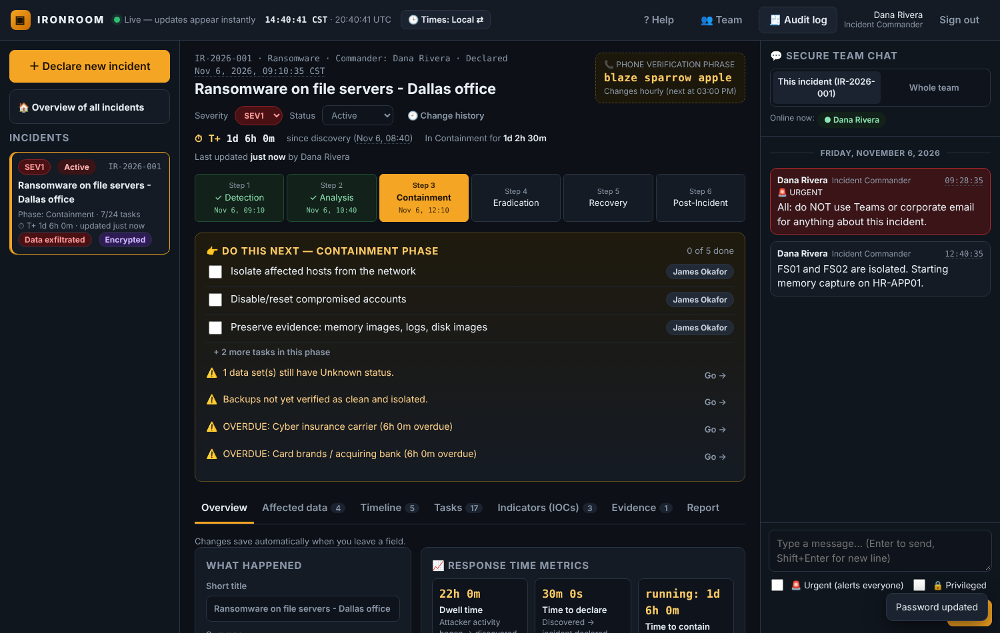

# IRONROOM: Cyber Incident Response Command Center

**IRONROOM** is a command center that runs out-of-band. You start it on a clean laptop (or a small box) connected to a phone hotspot or travel router. The response team then works from it, away from the corporate network the attacker may control.

> **Design premise (from the challenge):** *the attacker has access to every internal system.* So IRONROOM doesn't trust or depend on any of them: no Active Directory/SSO, no corporate email, no corporate DNS, no cloud, no CDN. It needs nothing beyond one Python process and a browser.



---

## 1. Quick start (5 minutes)

**You need:** Python 3.10+ on Windows, macOS or Linux.

```bash
# 1. Install dependencies (one time)
pip install -r requirements.txt

# 2. Start with demo data (sample ransomware incident + 5 demo users)
python server.py --demo
```

1. It asks for a **vault passphrase** (12+ characters). This passphrase is the encryption key. Don't lose it, because without it the data can't be recovered.
2. The terminal prints each user's **temporary password** and **authenticator key**, plus a QR code for `admin`.
3. On your phone, open any authenticator app (Google Authenticator, Microsoft Authenticator, Authy). Scan the QR code, or type in the key.
4. Open **https://localhost:8443** in your browser. The browser warns about the certificate, which is expected because the certificate is self-signed. Check that the fingerprint matches the one printed in the terminal, then continue.
5. Sign in with the username, temporary password and 6-digit code. You'll be asked to set a new password.

Demo accounts: `admin`, `ic.rivera` (Incident Commander), `j.okafor` (Responder), `counsel.lee` (Legal), `ceo.patel` (Executive / read-only).

For a real deployment, run `python server.py` without `--demo`. Only an `admin` account is created.

| Option | Meaning |
|---|---|
| `--allow 10.42.0.0/24` | **Only devices on this subnet can connect.** Set this to your hotspot's network. |
| `--port 8443` | HTTPS port |
| `--data ./vault` | Where the encrypted database lives (e.g. an encrypted USB stick) |
| `IRONROOM_PASSPHRASE` env var | Supply the passphrase non-interactively (testing only) |

---

## 2. How the requirements are met

| # | Requirement | What IRONROOM does |
|---|---|---|
| 1 | **Highly secure, isolated inside a compromised network** | Self-contained single process on its own hardware/network. Network allowlist (CIDR). HTTPS only. Data encrypted at rest with a key that never touches disk. See §3. |
| 2 | **Access control: admin adds people** | **Team & Access** screen: add a person, choose one of 5 roles, and get a one-time printable **sign-in card** (temporary password + authenticator QR code). Admins can change roles, disable accounts (which signs that person out instantly) and reset a lost phone. |
| 3 | **Incident documentation to standards, real-time status** | Each incident follows the **NIST SP 800-61** lifecycle (Detection → Analysis → Containment → Eradication → Recovery → Post-Incident). Fields follow common IR reporting practice: category, severity, start/discovery times, detection source, attack vector, threat actor, affected systems, business impact, external case numbers. It has a timestamped **timeline**, an **IOC register** and **phase task checklists**. Every change reaches every screen within milliseconds over WebSockets. |
| 4 | **Scope: what data, what state** | **Affected data** tab: each data set records the kinds of data in it (PII, PHI, PCI, privileged…), the record count, the storage location, the **status** (*Accessed / Exfiltrated / Encrypted (ransomware) / Deleted / Modified / Contained / Restored / Unknown*), the **confidence** level (Suspected / Likely / Confirmed) and where the affected people live. A status tile bar gives a summary. Every status change is written to the timeline automatically. |
| 5 | **Real-time communications** | Built-in chat with one channel per incident plus a team-wide channel. It shows who is online. An **Urgent** flag puts a red banner and alert on everyone's screen. Any chat message can be added to the official timeline with one click. |

---

## 3. Security model ("assume the attacker owns everything internal")

| Threat | Control |
|---|---|
| Attacker reads corporate email/Teams/Slack | IR communications move into IRONROOM. Nothing is sent through corporate systems. |
| Attacker controls AD / SSO / password resets | IRONROOM has its own accounts. Passwords are hashed with **Argon2id**, and **TOTP MFA is mandatory for everyone**. Each code works only once (replay protection). |
| Attacker on the network sniffs or tampers with traffic | HTTPS only. The server generates its own TLS certificate (ECDSA P-384) on first run, and its **fingerprint is printed** so users can verify it out-of-band. HSTS is set. |
| Attacker devices reach the server | **CIDR allowlist**: connections from outside the out-of-band subnet are refused before any application code runs. |
| Laptop or disk stolen / imaged | **Everything is encrypted at rest** with AES-256-GCM: incidents, chat, users, password hashes, MFA secrets and the audit log. The key is derived with **scrypt** from a passphrase typed at startup and **is never written to disk**. A wrong passphrase means the server refuses to start. |
| Stolen session / cookie | Sessions are held **in RAM only** and stored as SHA-256 hashes. The cookie is `__Host-`, `HttpOnly`, `Secure`, `SameSite=Strict`. Sessions are **bound to the client IP**, expire after **15 minutes idle** or **8 hours** total, and all of them end on server restart. |
| Brute force | Generic error messages (no username enumeration), timing equalization for unknown users, **account lock after 5 failures**, per-device rate limit (10 failures / 10 min). |
| Compromised IRONROOM account | **⛔ Lockdown** button ends every session instantly. Disabling one user ends their sessions and live connection immediately. |
| XSS / injection | **Strict CSP** (`script-src 'self'`, no inline script). The front end never uses `innerHTML`: all user data goes through `textContent`. The server validates every field against a whitelist, and every SQL query is parameterized. |
| CSRF / clickjacking / cross-site WebSocket | CSRF token on every state-changing request. `X-Frame-Options: DENY` and `frame-ancestors 'none'`. The WebSocket checks the Origin header and is **push-only** (all writes go through the CSRF-protected API). |
| Insider edits history to cover tracks | The **audit log is tamper-evident**. Every sign-in, change and export is HMAC-chained to the entry before it. **Verify integrity** pinpoints the exact entry that was altered, removed or reordered. Chat messages can't be edited. |
| Phone-call impersonation (deepfake CEO / fake IT) | The **phone verification phrase** is 3 words that change every hour and are visible only to signed-in team members. Callers have to read it out. |
| Leakage of legal strategy | Notes and messages can be marked **🔒 Privileged**. They are filtered **on the server**, so responders and viewers never receive them. |
| Footprint | No API docs or schema exposed, no `Server` banner, `no-store` on API responses, 256 KB request limit, SQLite `secure_delete`. |

**Roles**

| Role | Can |
|---|---|
| Administrator | Everything, plus manage people, Lockdown, audit log |
| Incident Commander | Run incidents, close them, see privileged items, audit log |
| Responder | Declare incidents, update data/tasks/timeline/IOCs, chat |
| Legal / Counsel | Edit, see and create privileged items, chat |
| Executive / Viewer | Read (non-privileged) and chat |

---

## 4. Ease of use under stress

- **"Do this next" box.** It always shows the next 3 tasks for the current phase, plus warnings in plain language (overdue deadlines, data with Unknown status, counsel not engaged, backups not verified). Each warning has a **Go →** button.
- **6-step phase bar.** It shows where you are at a glance. One click moves the incident to another phase, with a confirmation.
- **Playbook checklists are loaded automatically** by incident type (Ransomware, Business Email Compromise, Data Exfiltration…).
- **Declaring an incident takes 4 questions** with big buttons and plain descriptions, e.g. "SEV1: Critical, business stopped or data stolen".
- **Autosave**, so there is no Save button to forget. Live updates never wipe out a field someone is typing in.
- **Plain words instead of jargon.** "Copied out / stolen" appears next to *Exfiltrated*, and "Locked by ransomware" next to *Encrypted*.
- **Numbered sign-in steps**, an auto-sign-out countdown, a **? Help** card, and the Escape key closes any window.

## 5. Timestamps (the record holds up in front of a regulator or court)

Every record in IRONROOM is timestamped to the second, in a format that can't be misread. It uses a 24-hour clock with a time-zone label, and hovering over any time shows it in UTC and in local time.

| Where | What is recorded |
|---|---|
| **Top bar** | Live clock in local time **and** UTC. One click switches every timestamp in the app (and the printed report) between local time and UTC. |
| **Server clock** | All times come from the IRONROOM server, not each person's laptop. If a device's clock is off by more than 2 minutes, a warning appears, because a wrong clock on one compromised machine shouldn't corrupt the record. |
| **Incident header** | Live **T+ timer** since discovery, time spent in the current phase, and when the incident was last updated and by whom. |
| **Phase bar** | The date and time the incident entered each phase. |
| **🕘 Change history** | Every phase, severity and status change, with the time, the old and new values, and the person who made it. |
| **📈 Response metrics** | **Dwell time** (attack started → discovered), **time to declare**, **time to contain**, **time to recover** and **total duration**. These are calculated automatically from the history and update live while the incident is running. |
| **Timeline** | Separates **event time** (when it happened) from **logged time** (when it was written down, and by whom). Entries written down more than 15 minutes after the event are tagged "recorded Xh after event". Entries are grouped by day, can be searched, and automatic entries can be hidden. |
| **Affected data** | Each data set has a **status history**: every change (e.g. Unknown → Accessed → Exfiltrated) with time, confidence level and person, plus "since…" under the current status. |
| **Tasks** | Who completed each task and when. |
| **Chat** | Every message shows the time to the second, with date separators. **Unread badges** appear on the channel you're not looking at. |
| **Notification deadlines** | Countdowns that update every second, plus the due date and time. |
| **Audit log** | Second-precision timestamps on every action. |
| **Report** | Includes response metrics, phase history, "status since" for each data set, event and logged times, and evidence hashes. It also states which time zone it uses. |

## 6. Evidence locker (chain of custody)

- Upload ransom notes, screenshots, log extracts or phishing emails (up to 25 MB). Each file is **encrypted on arrival** and fingerprinted with **SHA-256**.
- Each item records when it was collected, when it was logged and by whom, and a **chain-of-custody log**. Every download is recorded with the time, person and device IP, and the file's hash is re-checked each time ("hash verified").
- Evidence **can't be edited or deleted**. If anyone tampers with a stored file on disk, the tampering is detected.
- Files are only ever served as downloads, so an uploaded HTML file can't run in the browser. File names are cleaned of path tricks and unusual characters. Executives/viewers can see the list but cannot download.

## 7. Extras (creativity)

1. **⏱ Notification deadline clocks**, worked out from the affected data. Examples: GDPR 72 h, HIPAA 60 days (and HHS for 500+ people), **Texas §521.053** 60 days for individuals and 30 days for the AG (250+ Texans), PCI, SEC 8-K Item 1.05 (4 business days after the materiality date) and the cyber insurer. They are colour-coded and can be ticked off when sent. *Labelled as defaults to confirm with counsel; not legal advice.*
2. **Attorney-client privilege workflow.** Privileged entries are filtered on the server. Reports carry a privilege banner. There are prompts to engage counsel and to retain forensics *through* counsel.
3. **📞 Rotating phone verification phrase** against vishing and deepfake impersonation.
4. **Tamper-evident audit chain** with one-click verification.
5. **Evidence package export** (JSON with the audit-chain verification result) and a **print-ready report** (Save as PDF) for insurers, regulators and the board.
6. **Emergency Lockdown** to sign everyone out at once.
7. **Presence**: see who is online right now.
8. **Chat → Timeline**: turn a message into an official timeline entry in one click.
9. **Copy all IOCs** to the clipboard for firewall/EDR blocklists.

---

## 8. Suggested 3-minute demo for judges

1. Start the server with `--demo`, and point out the passphrase prompt and the certificate fingerprint.
2. Sign in as **ic.rivera** in one browser and **ceo.patel** in a private window, side by side.
3. Walk through the **Do this next** box, the **T+ timer**, the phase bar with timestamps, the overdue notification clocks and the verification phrase. Click **Times: Local ⇄** to switch everything to UTC.
4. **Affected data**: change *Billing system* from Unknown to Contained, and the CEO's screen updates instantly.
5. Send an **🚨 Urgent** chat message, and the CEO gets a red banner.
6. **Timeline**: Rivera sees the 🔒 privileged counsel entry, and the CEO doesn't.
7. **Evidence**: upload a file, download it, and show the chain-of-custody entry that appears. Then **Overview → Response metrics**.
8. Sign in as **admin**: add a person and show the sign-in card. Then **Audit log → Verify integrity**.
9. Press **⛔ Lockdown**, and everyone is signed out immediately.

## 9. Tests

`tests/security.py` checks **27 security properties** against a running demo server: TOTP replay, user enumeration, CSRF, role enforcement, server-side privilege filtering, input validation, body size, headers, cookie flags, encryption at rest, audit-tamper detection, evidence encryption and integrity, filename sanitizing, and download-only serving. `tests/e2e.py` drives two browsers to check real-time sync, alerts, roles, user creation and Lockdown. `tests/e2e_v2.py` checks clocks, phase timestamps, the timeline filter, evidence upload/download (byte-identical) with custody logging, status history, unread badges and the UTC toggle.

## 10. Limitations / production roadmap

- One server process. For high availability, run a warm spare from an encrypted backup of `vault/`.
- The TLS private key is stored unencrypted next to the vault. In production, keep `--data` on an encrypted USB drive or volume.
- Evidence is stored inside the encrypted database. Very large forensic images (disk or memory dumps) belong in dedicated forensic storage, with only their hashes logged here.
- The server clock should be synced once before deployment (e.g. to a GPS clock or a trusted phone), because it's the source of truth for every timestamp.
- Optional hardware keys (WebAuthn/FIDO2) and Signal/SMS out-of-band paging.
- All users can see all incidents. Per-incident membership would be the next access-control layer.

## Architecture

```
server.py          FastAPI + Uvicorn (HTTPS, WebSockets), SQLite (ciphertext only)
static/index.html  Shell (no inline script)
static/app.js      Vanilla JS app, no framework, no CDN, ~1,100 lines
static/app.css     Styles (dark "command center" theme, print styles for reports)
```
Dependencies: `fastapi`, `uvicorn[standard]`, `cryptography`, `argon2-cffi`, `pyotp`, `qrcode[pil]`.
